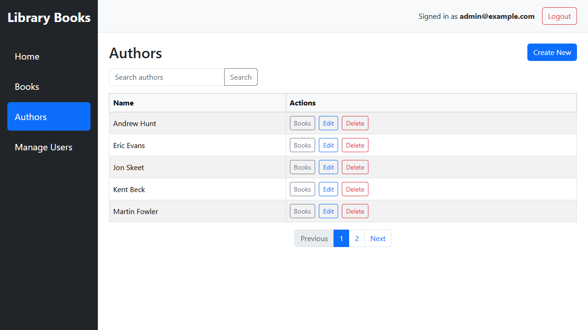
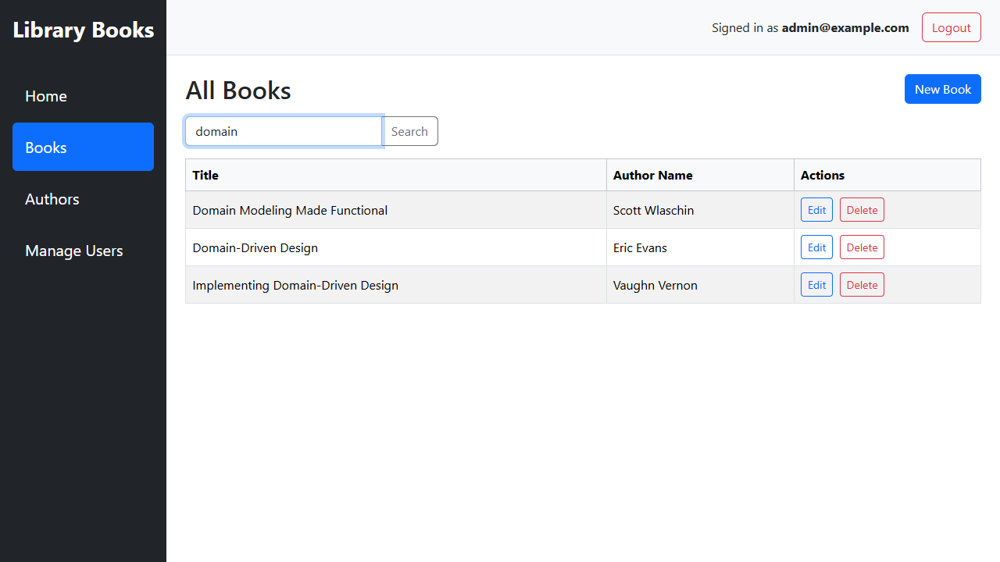
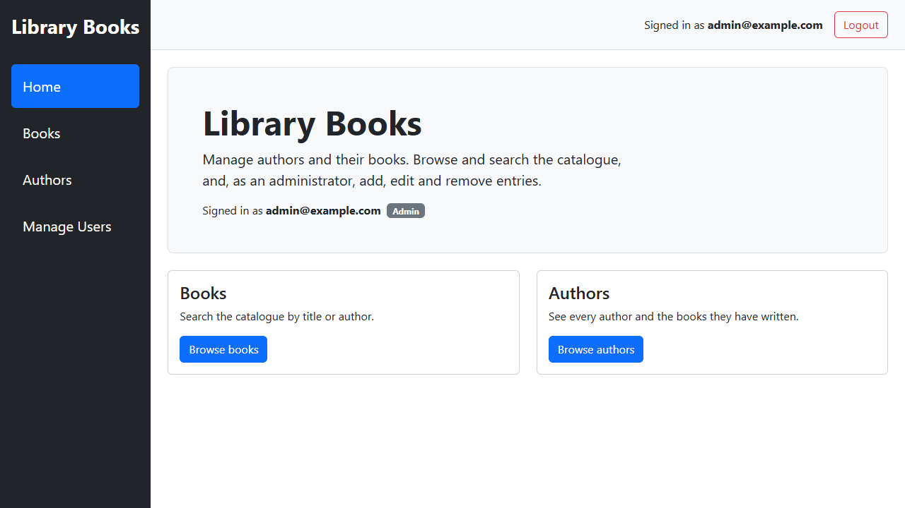
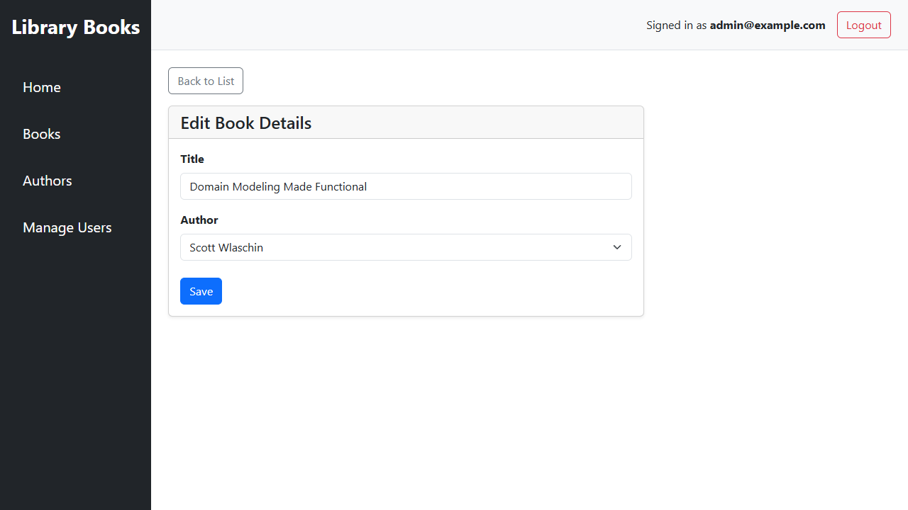
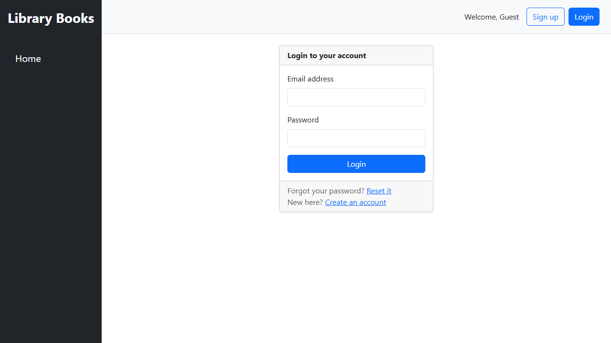
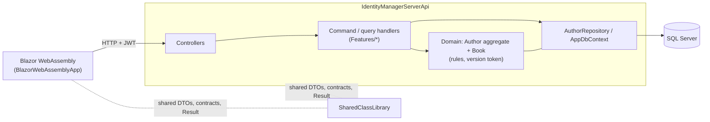

# AuthorBooksBlazorCore

[](https://github.com/HoughAPH/AuthorBooksBlazorCore8App/actions/workflows/ci.yml)

[](LICENSE)

A small but complete **ASP.NET Core Web API + Blazor WebAssembly** application for managing authors and their books, built to show how a modest .NET system can be structured with real domain rules, secure defaults and meaningful tests.

## What this demonstrates

| Area | What you will find |
|---|---|
| **Domain-driven design** | `Author` is an aggregate root and `Book` its child. All writes go through aggregate methods that enforce the rules (unique title per author, no deleting an author who has books) and raise a typed `DomainException`. |
| **Optimistic concurrency** | Each aggregate carries a `Version` token that changes on every change to the author or its books. A stale edit (or two simultaneous writers) is rejected with `409 Conflict` instead of silently overwriting. |
| **CQRS-style handlers, no MediatR** | `Features/{Authors,Books,Account}/{Commands,Queries}`: one file per use case, explicit handler registration, `Result` / `Result<T>` as the only outcome type. |
| **Consistent HTTP contract** | Failures are `application/problem+json` with the right status (400/401/404/409/429). A global exception handler maps domain exceptions. |
| **Server-side paging and search** | `GetAuthorsPage` and `GetBooksPage` return `PagedResult<T>` with a bounded page size; the Blazor lists use them. |
| **Authentication and authorization** | ASP.NET Core Identity for users and roles, JWT bearer tokens, role-based endpoints (`Admin` / `User`), account lockout and per-user rate limiting on write endpoints. |
| **Secrets handled properly** | No secrets in the repo: .NET user secrets locally (`scripts/setup.ps1`), environment variables or `.env` in Docker. The API refuses to start with a missing or short signing key. |
| **Testing** | 140+ NUnit tests: domain unit tests, controller tests, and API integration tests through `WebApplicationFactory` on in-memory SQLite, including concurrency races and rate limiting. |
| **Operability** | `/health` (database-backed) and `/health/live`, Serilog (console + SQL), security headers, CI on GitHub Actions, and a Docker Compose setup. |

## Screenshots

Plain Bootstrap 5 styling, no custom theme. Admins get the Create / Edit / Delete actions; regular users see the same lists read-only.

| Authors | Books (server-side search) |
|---|---|
|  |  |

| Home | Edit book | Login |
|---|---|---|
|  |  |  |

## Architecture



Request flow: a controller receives the request, hands a command or query to its handler, the handler loads the `Author` aggregate (always with its books), calls a domain method, and saves through the repository. Domain rule violations become `Result` failures that the controller maps to HTTP; races are caught by the version token and the unique `(AuthorId, Title)` index.

## Background

This solution started from the original task requirement on the `master` branch, where only the API was needed.

The Blazor WebAssembly application was added afterwards as a client so that the API endpoints could be exercised properly from a UI and not only through Swagger or ad hoc HTTP calls. It is therefore not the original requirement, but an extension to prove the API surface and authentication flow end to end.

## Solution overview

This is a .NET 10 solution built around a simple author and book management domain.

At a high level the solution uses:

- ASP.NET Core Web API
- Blazor WebAssembly
- Entity Framework Core
- ASP.NET Core Identity
- Aggregate root + repository, with command/query handlers
- Shared contracts and DTOs through a class library

The design is not pure MVC in the classic ASP.NET MVC sense, but it follows the same separation of concerns:

- presentation/client concerns in the Blazor app
- HTTP endpoint concerns in the API
- use cases in command/query handlers, data access in the repository and EF Core
- shared contracts, DTOs, and models in the shared library

## Projects

### `IdentityManagerServerApi`

This is the main API project and the original focus of the task.

Responsibilities include:

- exposing HTTP endpoints
- configuring EF Core and SQL Server access
- configuring ASP.NET Core Identity
- handling authentication and authorization
- registering command/query handlers and repositories
- exception handling and problem details
- Swagger/OpenAPI support
- Serilog configuration

This project also contains:

- `AppDbContext`
- migrations
- controllers
- repository implementations
- Identity user implementation

### `BlazorWebAssemblyApp`

This project was added afterwards as a consumer of the API.

Its purpose is mainly practical:

- call the API from a browser client
- test authentication and authorization flow
- expose the CRUD endpoints through a simple UI
- validate the shared contracts from a real client application

It includes pages for:

- authors
- books
- login
- registration
- forgot password
- reset password
- user management

The account and user management pages are intentionally pragmatic. They are there to exercise the API and Identity features. They are not intended to represent a production-complete identity UI. In particular, there is no email service wired in for a realistic password reset flow.

### `SharedClassLibrary`

This project contains the shared application types used across both the API and the Blazor client.

Typical contents include:

- contracts/interfaces
- DTOs
- domain models
- response wrappers

The intention is to avoid duplicating request/response contracts between server and client.

## Architecture notes

- **Aggregate and repository.** `Author` is the aggregate root; `Book` is only reachable through it, and there is no `DbSet<Book>`. `IAuthorRepository` loads and saves whole aggregates, so every rule lives in one place.
- **Commands and queries.** Writes are commands that load the aggregate, call a domain method and save. Reads are queries that project straight from `AppDbContext` to DTOs (`AsNoTracking`), without loading aggregates.
- **Results, not exceptions, across the API boundary.** Handlers return `Result` / `Result<T>`; `ResultExtensions.ToActionResult` turns them into HTTP responses. A `DomainException` that escapes is mapped by the global exception handler.
- **Concurrency.** `Author.Version` is an EF concurrency token that the aggregate replaces on every change. The client sends back the version it read; a mismatch (or a race caught by EF) is a `409`. The unique `(AuthorId, Title)` index backs the duplicate-title rule for any write that bypasses the version.
- **Paging.** List endpoints that can grow (`GetAuthorsPage`, `GetBooksPage`) page and search on the server with a capped page size. The un-paged `GetAuthors` / `GetBooks` remain for dropdowns and simple consumers.

For a system this small the structure is more than strictly necessary; it is deliberate, to show where each concern lives and how it is tested.

## Authentication and user management

The API uses ASP.NET Core Identity for users and roles and issues JWT bearer tokens at login. The Blazor client stores the token and attaches it to API calls.

The Blazor client includes pages for account-related actions and a basic user manager page so that the Identity endpoints can be exercised from the UI.

This is functional, but deliberately lightweight:

- no email sender is configured
- forgot/reset password is therefore limited by that constraint
- the user management surface is mainly there to support testing and demonstration

## Security

This solution is a simple demonstrator for authentication and authorization in ASP.NET Core.

Authentication uses JWT bearer tokens issued by the API (Identity is used only for user and role storage). Role-based authorization restricts selected endpoints and application actions by role.

That said, this repository should still be viewed as a learning and demonstration project rather than a production security template. Some areas are intentionally simplified, especially around password recovery, operational hardening, and full production identity workflows.

## Why the Blazor client was added

The API on its own satisfies the original task intent. The Blazor client was added to answer a practical question: can the API actually be consumed cleanly from an application that has to authenticate, call endpoints, and handle user workflows?

That addition made it easier to validate:

- CORS setup
- JWT bearer authentication behaviour
- protected endpoints
- CRUD flows
- shared DTO usage
- basic account flows

## Quickstart (Windows, local development)

### Prerequisites

- [.NET 10 SDK](https://dotnet.microsoft.com/download)
- SQL Server LocalDB (installed with Visual Studio's "ASP.NET and web development" or "Data storage and processing" workload, or with SQL Server Express). Development uses `(localdb)\MSSQLLocalDB` and creates the `AuthorBooksDb` database for you.

### Steps

```powershell
git clone https://github.com/HoughAPH/AuthorBooksBlazorCore8App.git
cd AuthorBooksBlazorCore8App

# 1. One-time: writes Jwt:Key and a generated admin login into .NET user secrets (outside the repo)
powershell -File scripts/setup.ps1

# 2. API (https://localhost:7202, Swagger at /swagger). In Development it applies the EF migrations and seeds the admin.
dotnet run --project IdentityManagerServerApi --launch-profile https

# 3. Client, in a second terminal (https://localhost:7254)
dotnet run --project BlazorWebAssemblyApp
```

The setup script prints the admin email and password once. Log in with them in the Blazor app. You can show them again later with `dotnet user-secrets list --project IdentityManagerServerApi`. Anyone can also register, which always creates a normal `User`.

Trust the dev HTTPS certificate once if you have not already: `dotnet dev-certs https --trust`.

### Where configuration lives

| Setting | Where | Notes |
|---|---|---|
| `ConnectionStrings:DefaultConnection` | `appsettings.Development.json` (LocalDB, no password) | Override with user secrets or `ConnectionStrings__DefaultConnection` to use another SQL Server |
| `Jwt:Issuer`, `Jwt:Audience` | `appsettings.json` | Not secret |
| `Jwt:Key` | **User secrets** (generated by `scripts/setup.ps1`) | Required, 32+ characters. Never commit it |
| `Seed:AdminEmail`, `Seed:AdminPassword`, `Seed:AdminName` | **User secrets** | Optional. The admin is created at startup if set |
| `Cors:AllowedOrigins` | `appsettings.json` | Defaults to the Blazor dev origin |
| `ApiSettings:BaseUrl` | `BlazorWebAssemblyApp/wwwroot/appsettings.json` | Public by nature: it is downloaded by the browser |

In any non-Development environment the secrets come from environment variables (`Jwt__Key`, `Seed__AdminPassword`, ...) or your host's secret store.

### Useful things to know

- **Reset the database:** `dotnet ef database drop --project IdentityManagerServerApi`, then start the API again.
- **Password reset:** there is no email sender. In Development the reset token is written to the API console log; paste it into the reset page. Outside Development the token is never exposed.
- **Migrations outside Development:** the API only auto-migrates in Development. Elsewhere run `dotnet ef database update --project IdentityManagerServerApi` or generate a script with `dotnet ef migrations script --idempotent`.
- **Tests:** `dotnet test AuthorBooksBlazorCore.Test` (in-memory SQLite, no database or secrets needed).
- **Not on Windows / no LocalDB:** point `ConnectionStrings__DefaultConnection` at any SQL Server instance.

## Quickstart with Docker (any OS)

Runs SQL Server, the API and the Blazor client together. Only Docker is needed, not the .NET SDK or LocalDB.

```bash
cp .env.example .env        # then edit .env: set JWT_KEY, ADMIN_PASSWORD and a strong SA_PASSWORD
docker compose up --build
```

- Client: <http://localhost:8081> (log in with `ADMIN_EMAIL` / `ADMIN_PASSWORD` from `.env`)
- API health: <http://localhost:8080/health> (database-backed) and <http://localhost:8080/health/live>
- The API applies the migrations on startup (`Database__MigrateOnStartup=true`) and seeds the admin. Data lives in the `sqldata` volume; `docker compose down -v` wipes it.
- Ports 8080 (API) and 8081 (client) must be free on the host. If they are not, change the `ports:` mappings in `docker-compose.yml`, the `Cors__AllowedOrigins__0` value and `docker/client-appsettings.json` together.
- `.env` is git-ignored and compose refuses to start while `JWT_KEY`, `ADMIN_PASSWORD` or `SA_PASSWORD` is unset, so there are no default credentials.
- This runs the API in the Production environment: Swagger is off and password-reset tokens are never exposed. This is a local demo stack over plain HTTP, not a hardened deployment.

## API at a glance

| Method and route | Purpose | Access |
|---|---|---|
| `GET /api/Author/GetAuthorsPage?pageNumber&pageSize&search` | Paged, searchable authors | Any signed-in user |
| `GET /api/Author/GetAuthors`, `GetAuthor/{id}` | All authors / one author (includes `version`) | Any signed-in user |
| `POST /api/Author/AddAuthor`, `PUT UpdateAuthor/{id}`, `DELETE DeleteAuthor/{id}` | Author writes; `UpdateAuthor` honours `version` | Admin, rate limited |
| `GET /api/Book/GetBooksPage?pageNumber&pageSize&search&authorId` | Paged, searchable books | Any signed-in user |
| `GET /api/Book/GetBooks`, `GetAuthorBooks/{id}`, `GetBook/{id}` | Un-paged reads | Any signed-in user |
| `POST AddBook`, `PUT UpdateBook/{id}`, `DELETE DeleteBook/{id}` | Book writes | Admin, rate limited |
| `POST /api/Account/register`, `login`, `forgot-password`, `reset-password` | Account flows | Anonymous, rate limited |
| `GET /health`, `/health/live` | Readiness (checks DB) / liveness | Anonymous |

Swagger UI is available at `/swagger` in Development.

## Current status

This is a working exercise solution with a practical client added on top of the API.

It should be viewed as:

- a task implementation for the API
- plus a Blazor client used to expose and invoke the API in a more realistic way

Some parts are intentionally simplified, especially around account recovery and production-grade identity workflows.

## Known limitations / roadmap

This is a demonstration project, not a production template. Deliberate simplifications:

- **Tokens:** JWTs live in the browser with no refresh tokens or server-side revocation (logout just discards the token).
- **Email:** no email sender is configured, so password reset is only usable in Development (the token is written to the API log).
- **Concurrency scope:** optimistic concurrency is enforced on the `Author` aggregate (which includes its books). User management is intentionally out of scope.
- **Transport:** the Docker setup is plain HTTP on localhost; put a TLS-terminating proxy in front for anything real.
- **Client tests:** the API and domain are covered by tests; the Blazor components themselves are not.
- **Observability:** structured logging only; no tracing or metrics yet.

Natural next steps: refresh tokens, an email sender, API versioning, bUnit tests for the client and OpenTelemetry.

## Summary

If reviewing the repository against the original requirement, the `master` branch represents the original task scope more directly.

This branch/solution goes further by adding:

- a Blazor WebAssembly client
- account pages
- a simple user manager UI
- a fuller demonstration of how the API can be consumed

That extra work was mainly to validate the API properly rather than leave it as a server-only exercise.