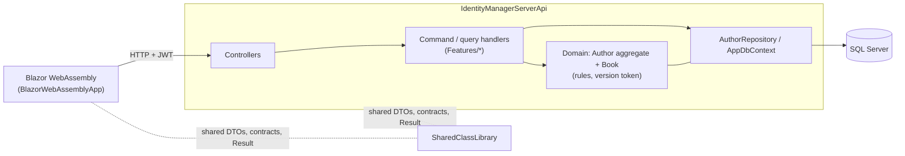

# AuthorBooksBlazorCore

[](https://github.com/HoughAPH/AuthorBooksBlazorCore8App/actions/workflows/ci.yml)

[](LICENSE)

A small but complete **ASP.NET Core Web API + Blazor WebAssembly** app for managing authors and their books, built to show how a modest .NET system can be structured with real domain rules, secure defaults and meaningful tests.

[Quickstart](#quickstart) · [Architecture](docs/architecture.md) · [Configuration](docs/configuration.md)

## What this demonstrates

| Area | What you will find |
|---|---|
| **Domain-driven design** | `Author` is an aggregate root with `Book` as its child; all writes go through methods that enforce the rules (unique title per author, no deleting an author who has books). |
| **Optimistic concurrency** | A `Version` token changes on every change to an author or its books; a stale or racing edit is rejected with `409 Conflict`. |
| **CQRS-style handlers, no MediatR** | One file per use case under `Features/`, and `Result` / `Result<T>` as the only outcome type. |
| **Consistent HTTP contract** | Failures are `application/problem+json` with the right status (400/401/404/409/429). |
| **Server-side paging and search** | `GetAuthorsPage` / `GetBooksPage` with a capped page size; the Blazor lists use them. |
| **Auth and security** | ASP.NET Core Identity, JWT bearer tokens, `Admin` / `User` roles, account lockout, per-user rate limiting on writes. |
| **Secrets handled properly** | Nothing secret in the repo: user secrets locally, `.env` in Docker. The API refuses to start with a missing or short signing key. |
| **Testing** | 140+ NUnit tests: domain, controllers, and API integration tests (in-memory SQLite) including concurrency races. |
| **Operability** | Database-backed `/health`, Serilog, CI on GitHub Actions, Docker Compose. |

## Screenshots

Plain Bootstrap 5, no custom theme. Admins get Create / Edit / Delete; regular users see the same lists read-only.

| Authors | Books (server-side search) |
|---|---|
|  |  |

| Home | Edit book | Login |
|---|---|---|
|  |  |  |

## Quickstart

### With Docker (any OS, needs only Docker)

```bash
cp .env.example .env        # edit .env: set JWT_KEY, ADMIN_PASSWORD and SA_PASSWORD
docker compose up --build
```

Open <http://localhost:8081> and log in with `ADMIN_EMAIL` / `ADMIN_PASSWORD` from `.env`. The API (<http://localhost:8080/health>) migrates the database and seeds the admin on startup. Ports 8080 and 8081 must be free; `docker compose down -v` wipes the data. This is a local demo over plain HTTP, not a hardened deployment.

### On Windows with the .NET 10 SDK and SQL Server LocalDB

```powershell
git clone https://github.com/HoughAPH/AuthorBooksBlazorCore8App.git
cd AuthorBooksBlazorCore8App

powershell -File scripts/setup.ps1                                          # once: generates secrets, prints the admin login
dotnet run --project IdentityManagerServerApi --launch-profile https       # API: https://localhost:7202 (Swagger at /swagger)
dotnet run --project BlazorWebAssemblyApp                                   # client, in a second terminal: https://localhost:7254
```

The setup script stores a generated `Jwt:Key` and admin credentials in .NET user secrets (outside the repo). In Development the API creates the database and applies migrations itself. Run `dotnet dev-certs https --trust` once if your browser distrusts the dev certificate. Details, other databases and secrets for other environments are in [docs/configuration.md](docs/configuration.md).

Run the tests with `dotnet test AuthorBooksBlazorCore.Test` (no database or secrets needed).

## How it's built



A controller hands a command or query to its handler. The handler loads the `Author` aggregate (always with its books), calls a domain method and saves through the repository. Rule violations become `Result` failures that the controller maps to HTTP, and races are caught by the version token and a unique `(AuthorId, Title)` index. More in [docs/architecture.md](docs/architecture.md).

## API at a glance

| Method and route | Purpose | Access |
|---|---|---|
| `GET /api/Author/GetAuthorsPage?pageNumber&pageSize&search` | Paged, searchable authors | Signed-in |
| `GET /api/Author/GetAuthors`, `GetAuthor/{id}` | All authors / one author (includes `version`) | Signed-in |
| `POST AddAuthor`, `PUT UpdateAuthor/{id}`, `DELETE DeleteAuthor/{id}` | Author writes; update honours `version` | Admin, rate limited |
| `GET /api/Book/GetBooksPage?pageNumber&pageSize&search&authorId` | Paged, searchable books | Signed-in |
| `GET /api/Book/GetBooks`, `GetAuthorBooks/{id}`, `GetBook/{id}` | Un-paged reads | Signed-in |
| `POST AddBook`, `PUT UpdateBook/{id}`, `DELETE DeleteBook/{id}` | Book writes | Admin, rate limited |
| `POST /api/Account/register`, `login`, `forgot-password`, `reset-password` | Account flows | Anonymous, rate limited |
| `GET /health`, `/health/live` | Readiness (checks the DB) / liveness | Anonymous |

## Known limitations

A demonstration project, not a production template:

- JWTs live in the browser, with no refresh tokens or server-side revocation.
- No email sender, so password reset only works in Development (the token is written to the API log).
- Optimistic concurrency covers the `Author` aggregate (and its books), not user management.
- The Docker setup is plain HTTP on localhost.
- The API and domain are well tested; the Blazor components are not.

Natural next steps: refresh tokens, an email sender, API versioning, bUnit tests and OpenTelemetry.

## Background

The original task needed only the API (see the `master` branch). The Blazor client was added afterwards to exercise the API, CORS and the authentication flow from a real UI instead of Swagger alone.

Licensed under the [MIT License](LICENSE).
